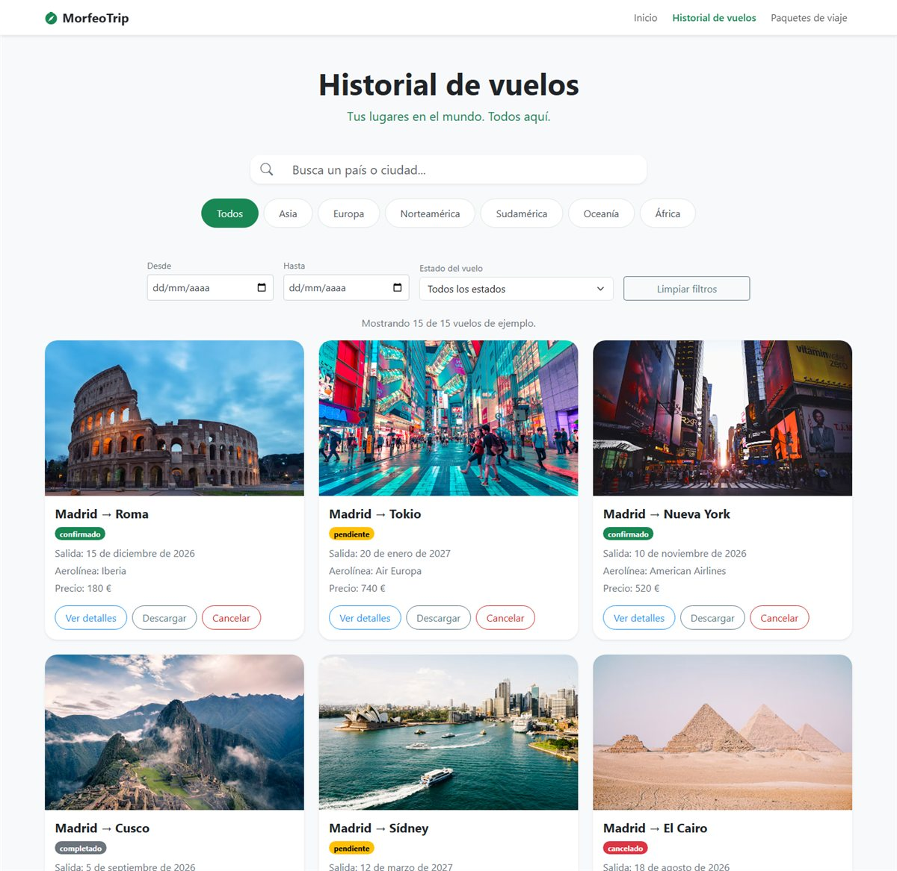

# MorfeoTrip · Agencia de Viajes

Aplicación web de ejemplo para una agencia de viajes, hecha con **Jakarta Faces (JSF)**, **PrimeFaces**, **CDI (Weld)** y **Bootstrap 5**, que se ejecuta sobre **Apache Tomcat 11**.

Permite buscar paquetes de viaje, ver el detalle de un paquete, simular el pago con tarjeta o transferencia, registrarse e iniciar sesión, consultar el perfil y navegar por un historial de vuelos con filtros.

---

## Integrantes

> Rellena aquí los nombres del grupo.

| Nombre y apellidos |
| --- | --- |
|  _Florencia Arando_ |
| _Daniel Ochoa_ | 
| _Joseph Caiza_ |
**Asignatura:** Desarrollo Web / Programación · **Curso:** 2026-2027

---

## 1. Qué es el proyecto

Es una aplicación **Jakarta EE** empaquetada como WAR. Toda la lógica de negocio vive en **beans CDI** (`@Named`) y las pantallas son **vistas Facelets (`.xhtml`)** que combinan etiquetas de JSF/PrimeFaces con HTML y clases de Bootstrap.

No necesita base de datos: los paquetes, usuarios, vuelos y pagos se guardan **en memoria** (listas y mapas dentro de los beans), por lo que al reiniciar Tomcat se vuelve al estado inicial. Es un proyecto académico, no un sistema real de reservas.

---

## 2. Funcionalidades

| Pantalla | Qué hace |
| --- | --- |
| `dashboard.xhtml` | Inicio. Buscador por país y rango de fechas, carrusel de ofertas y de destinos destacados. Botón **Reservar** en cada paquete. |
| `busqueda.xhtml` | Resultados de la búsqueda: muestra los paquetes que coinciden con el país y la duración elegidos. |
| `detallePaquete.xhtml` | Ficha completa del paquete (imagen, destino, duración, valoración, hotel, incluidos, itinerario y carrusel de fotos). Botón **Comprar paquete**, que abre el pago. |
| `pago.xhtml` | Resumen del pedido y pago simulado con **tarjeta** o **transferencia bancaria**, con validación de campos y ventana emergente de pago realizado. |
| `login.xhtml` | Inicio de sesión. Al autenticarse redirige al **dashboard**. |
| `register.xhtml` | Alta de usuario con validación de correo, contraseña y confirmación. |
| `perfil.xhtml` | Datos de la cuenta y opción de eliminar la cuenta. |
| `historialVuelos.xhtml` | Historial de vuelos de ejemplo: búsqueda por texto, filtros por continente, fechas y estado, diálogo de detalles, descarga del itinerario en `.txt` y cancelación. |

**Usuario de prueba:** `admin` / `1234`.

---

## 3. Tecnologías utilizadas

| Tecnología | Versión | Para qué se usa |
| --- | --- | --- |
| Java | 17 | Lenguaje de los beans y servicios (`maven.compiler.release`). |
| Jakarta Faces (Mojarra) | 4.1.4 | Framework de vistas: `h:form`, `h:inputText`, plantillas Facelets, navegación, mensajes. |
| PrimeFaces (classifier `jakarta`) | 15.0.9 | Componentes: `p:commandButton`, `p:carousel`, `p:datePicker`, `p:dialog`, `p:growl`, `p:messages`, iconos `pi`. |
| CDI / Weld | 6.0.3.Final | Inyección de dependencias y ámbitos (`@Named`, `@SessionScoped`, `@ViewScoped`, `@ApplicationScoped`). |
| Jakarta Servlet API | 6.1.0 (`provided`) | API del contenedor; la aporta Tomcat. |
| Bootstrap | 5.3.8 (plantilla) / 5.3.3 (login, registro, historial) | Maquetación, tarjetas, pestañas, formularios y utilidades responsive. Se carga por CDN. |
| Maven | 3.6+ | Compilación y empaquetado del WAR. |
| Apache Tomcat | 11 | Servidor de aplicaciones (Jakarta EE 11 / Servlet 6.1). |
| JavaScript | — | `resources/js/pago.js`: formato y validación del formulario de pago. |

Imágenes: los destinos usan fotos remotas de Unsplash y el logo/banner son SVG locales (`resources/images/`), por lo que **hace falta conexión a internet** para verlas y para cargar Bootstrap desde el CDN.

---

## 4. Requisitos previos

Antes de ejecutar el proyecto necesitas:

1. **JDK 17 o superior** instalado y `JAVA_HOME` apuntando a él.
   ```bash
   java -version
   javac -version
   ```
2. **Maven 3.6 o superior**.
   ```bash
   mvn -version
   ```
3. **Apache Tomcat 11** descargado y funcionando (versión 11, porque el proyecto usa Servlet 6.1 / Jakarta EE 11; en Tomcat 9 o 10 no arranca).
4. Conexión a internet para Bootstrap, PrimeFaces (se empaqueta) e imágenes de Unsplash.

---

## 5. Cómo descargar y ejecutar

### 5.1 Descargar el proyecto

Con Git:

```bash
git clone <URL-del-repositorio>
cd appViajes
```

O descarga el ZIP del repositorio y descomprímelo.

> La aplicación Maven está en la carpeta **`pruebas-tomcat`**. Todos los comandos de Maven se ejecutan dentro de esa carpeta.

### 5.2 Compilar

```bash
cd pruebas-tomcat
mvn clean package
```

Se genera el fichero **`pruebas-tomcat/target/appViajes.war`**.

### 5.3 Desplegar en Tomcat

**Opción A (manual, la más sencilla):** copia el WAR a la carpeta `webapps` de Tomcat y arráncalo.

```bash
cp target/appViajes.war "$CATALINA_HOME/webapps/"
"$CATALINA_HOME/bin/startup.sh"      # startup.bat en Windows
```

**Opción B (perfiles Maven del `pom.xml`):**

```bash
# Copia el WAR a una ruta fija de Tomcat (revisa la ruta en el perfil deploy-local)
mvn -Pdeploy-local install

# O copia los recursos web a la aplicación expandida usando CATALINA_HOME
set CATALINA_HOME=C:\apache-tomcat-11.0.27
mvn -Pdeploy-web install
```

El perfil `deploy-local` tiene la ruta `C:\apache-tomcat-11.0.27\webapps` escrita en el `pom.xml`: **cámbiala por la de tu Tomcat** o usa la opción A.

### 5.4 Abrir la aplicación

Con Tomcat en marcha:

```
http://localhost:8080/appViajes/
```

Entra con **`admin` / `1234`** o crea una cuenta desde **Crear cuenta**.

---

## 6. Cómo funciona

### 6.1 Arquitectura

```
Navegador (HTML + Bootstrap + JS)
        │  peticiones HTTP / AJAX
        ▼
Tomcat 11  ──►  FacesServlet (*.xhtml)  ──►  Vistas Facelets (.xhtml)
                        │
                        ▼
              Beans CDI (@Named)  ──►  Servicio / Modelo (en memoria)
```

- El **`FacesServlet`** está mapeado a `*.xhtml` en `WEB-INF/web.xml`.
- **Weld** arranca por el listener declarado en `web.xml` y activa CDI (`WEB-INF/beans.xml`).
- Las vistas que comparten cabecera y pie usan la plantilla **`WEB-INF/templates/templateAgencia.xhtml`**, que define los huecos `title`, `head`, `bannerTitulo`, `bannerSubtitulo` y `content`.
- Las pantallas de **login**, **registro** e **historial** son páginas completas con su propia cabecera, no usan la plantilla.

### 6.2 Flujo principal (reserva y pago)

1. En `dashboard.xhtml` se pulsa **Reservar** → `DashboardBean.reservar(paquete)` guarda el paquete en la sesión (`paqueteSeleccionado`) y redirige a `detallePaquete.xhtml`.
2. `DetallePaqueteBean` lee ese paquete de la sesión y pide los datos extra (hotel, incluidos, fotos, itinerario) a `DetallePaqueteServicio.buscarPorId(...)`. La ficha se pinta con esos datos.
3. Al pulsar **Comprar paquete**, `DetallePaqueteBean.irAPago()` vuelve a dejar el paquete en la sesión y navega a `pago.xhtml`.
4. `PagoBean` recupera el paquete y el detalle desde `DetallePaqueteServicio`, calcula el total y muestra el resumen (componente `resumenPago`).
5. Al pagar, `pago.js` valida los campos en el navegador y, si todo está bien, se ejecuta `pagarConTarjeta()` o `pagarConTransferencia()` en `PagoBean`: se genera una referencia `MT-XXXXXXXX` y se abre la ventana **"¡Pago completado con éxito!"**.
6. El pago es **simulado**: no se cobra nada, no hay pasarela real y **la reserva no se añade al historial de vuelos** (el historial muestra vuelos de ejemplo).

### 6.3 Navegación y sesión

- `LoginBean.login()` valida con `UsuarioBean.autenticar(...)` y redirige a `dashboard.xhtml`.
- `UsuarioBean` es de sesión (`@SessionScoped`): guarda el usuario autenticado y la lista de usuarios registrados en memoria.
- La cabecera de la plantilla muestra "Iniciar sesión / Crear cuenta" o el saludo y "Cerrar sesión" según `usuarioBean.logged`.

---

## 7. Estructura del proyecto

```
appViajes/
├── README.md
├── pruebas-tomcat/                     ← aplicación Jakarta EE (proyecto Maven)
│   ├── pom.xml                         Dependencias, plugins y perfiles de despliegue
│   └── src/main/
│       ├── java/es/fempa/
│       │   ├── DashboardBean.java          Inicio: buscador, ofertas, reservar
│       │   ├── DetallePaqueteBean.java     Ficha del paquete y paso al pago
│       │   ├── PagoBean.java               Pago simulado y datos de la vista de pago
│       │   ├── LoginBean.java              Autenticación
│       │   ├── RegisterBean.java           Alta de usuarios
│       │   ├── UsuarioBean.java            Usuarios y sesión
│       │   ├── HistorialVuelosBean.java    Vuelos de ejemplo, filtros y acciones
│       │   ├── converter/CiudadConverter.java
│       │   ├── modelo/                     Ciudad, PaqueteViaje, DetallePaquete
│       │   ├── servicio/DetallePaqueteServicio.java
│       │   └── utilidades/Util.java
│       └── webapp/
│           ├── WEB-INF/
│           │   ├── web.xml                 FacesServlet, Weld y modo desarrollo
│           │   ├── beans.xml               Activa CDI
│           │   └── templates/templateAgencia.xhtml
│           ├── dashboard.xhtml
│           ├── busqueda.xhtml
│           ├── detallePaquete.xhtml
│           ├── pago.xhtml
│           ├── login.xhtml
│           ├── register.xhtml
│           ├── perfil.xhtml
│           ├── historialVuelos.xhtml
│           └── resources/
│               ├── components/             carruselFotos, resumenPago, bannerOld
│               ├── images/                 logo.svg, banner.svg, destinos *.svg
│               └── js/pago.js              Validación y formato del pago
│
├── index.html, login.html, register.html,
│   historialVuelos.html, pago.html        Prototipos estáticos originales (referencia)
└── docs/capturas/                         Capturas usadas en este README
```

> `pruebas-tomcat/target/` es la salida de la compilación (WAR, clases y copia expandida). Se puede borrar con `mvn clean`.

Los ficheros `.html` de la raíz son las **maquetas estáticas** con las que empezó el proyecto: no forman parte del WAR y no se sirven desde Tomcat. Se conservan como referencia de diseño.

---

## 8. Vistas y beans

### Vistas

| Fichero | Plantilla | Contenido principal |
| --- | --- | --- |
| `dashboard.xhtml` | Sí | Buscador (`p:datePicker`, `h:selectOneMenu`), `p:carousel` de ofertas y destinos. |
| `busqueda.xhtml` | Sí | Resumen de la búsqueda y tarjetas de resultados. |
| `detallePaquete.xhtml` | Sí | Ficha del paquete, incluidos, itinerario y carrusel de fotos. |
| `pago.xhtml` | Sí | Resumen del pedido, pestañas tarjeta/transferencia, `p:dialog` de éxito. |
| `login.xhtml` | No | Formulario de acceso. |
| `register.xhtml` | No | Formulario de alta. |
| `perfil.xhtml` | Sí | Datos del usuario y baja de cuenta. |
| `historialVuelos.xhtml` | No | Historial con filtros, `p:dialog` de detalle y descarga. |

### Beans (`@Named`)

| Bean | Ámbito | Responsabilidad |
| --- | --- | --- |
| `DashboardBean` | `@SessionScoped` | Ciudades, países, ofertas, destinos, búsqueda y reserva. |
| `DetallePaqueteBean` | `@RequestScoped` | Recupera el paquete seleccionado y su detalle; abre el pago. |
| `PagoBean` | `@ViewScoped` | Datos del pago, importe y acción de pagar (simulada). |
| `LoginBean` | `@ViewScoped` | Credenciales y redirección al dashboard. |
| `RegisterBean` | `@ViewScoped` | Validación y alta de usuarios. |
| `UsuarioBean` | `@SessionScoped` | Lista de usuarios, usuario autenticado, logout. |
| `HistorialVuelosBean` | `@ViewScoped` | Vuelos de ejemplo, filtros, detalle, descarga y cancelación. |
| `DetallePaqueteServicio` | `@ApplicationScoped` | Catálogo de detalles por id del paquete. |

---

## 9. Componentes reutilizables

Están en `webapp/resources/components/` y se invocan con el prefijo `jakarta.faces.composite/components`:

| Componente | Atributos | Uso |
| --- | --- | --- |
| `resumenPago.xhtml` | `detalle` (obligatorio) | Tarjeta con el resumen del pedido en la pantalla de pago. |
| `carruselFotos.xhtml` | `fotos`, `titulo`, `descripcion`, `alt` | Carrusel Bootstrap de fotos del destino. |
| `bannerOld.xhtml` | — | Banner antiguo conservado como referencia. |

Ejemplo de uso:

```xml
<pago:resumenPago detalle="#{pagoBean.detalle}"/>
```

---

## 10. Validaciones y mensajes

- **Pago (`pago.js`)**: campos obligatorios, nombre del titular, número de tarjeta con **algoritmo de Luhn**, caducidad `MM/AA` no vencida, CVV de 3-4 dígitos, correo válido y aceptación de condiciones. Muestra el error bajo cada campo, un aviso resumen y bloquea el envío (`onstart` devuelve `false`). También da formato automático al número y a la fecha.
- **Registro**: correo con formato válido, contraseña de 8+ caracteres con una mayúscula y un número, confirmación y usuario no duplicado.
- **Login**: usuario y contraseña obligatorios.
- Los mensajes se muestran con `p:messages` / `p:growl` según la pantalla.

---

## 11. Capturas

### Inicio (dashboard)


### Iniciar sesión


### Historial de vuelos



Puedes añadir capturas del detalle del paquete y del pago guardándolas en `docs/capturas/` con estos nombres:

| Fichero | Pantalla |
| --- | --- |
| `04-detallePaquete.jpg` | Ficha de un paquete |
| `05-pago.jpg` | Resumen y métodos de pago |
| `06-pago-exito.jpg` | Ventana de pago realizado |

Y enlazarlas así:

```markdown


```

---

## 12. Problemas frecuentes

| Síntoma | Causa y solución |
| --- | --- |
| `404` al abrir `/appViajes/` | El WAR no está desplegado o Tomcat aún está arrancando. Revisa `logs/catalina.*.log`. |
| Error de compilación por versión de Java | `JAVA_HOME` debe apuntar a un **JDK 17+**. |
| La app no arranca en Tomcat 9 | El proyecto usa Jakarta EE 10: necesita **Tomcat 11**. |
| No se ven los iconos `pi` o Bootstrap | Falta conexión a internet (CDN) o PrimeFaces no se empaquetó en el WAR. |
| Cambio un `.xhtml` y no se refleja | Recompila (`mvn clean package`) y vuelve a desplegar; si es JavaScript, fuerza recarga con **Ctrl+F5**. |
| El JavaScript del pago parece no ejecutarse | El navegador guardó una versión antigua. `web.xml` ya pone Faces en modo `Development` (sin caché de recursos): fuerza una recarga. |
| Puerto 8080 ocupado | Cambia el puerto en `conf/server.xml` de Tomcat o detén el proceso que lo usa. |

---

## 13. Posibles mejoras

- Guardar usuarios, paquetes y reservas en una base de datos (JPA) en lugar de memoria.
- Añadir la reserva pagada al historial de vuelos del usuario.
- Integrar una pasarela de pago real (Stripe, Redsys…).
- Internacionalización de textos y precios.
- Pruebas automatizadas de los beans y del flujo de compra.
