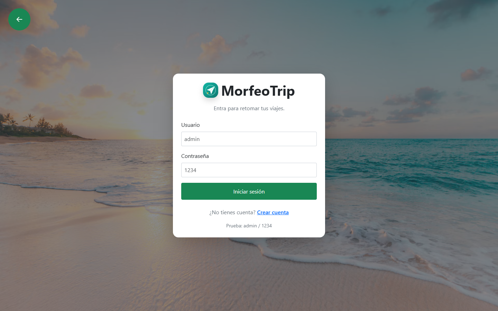
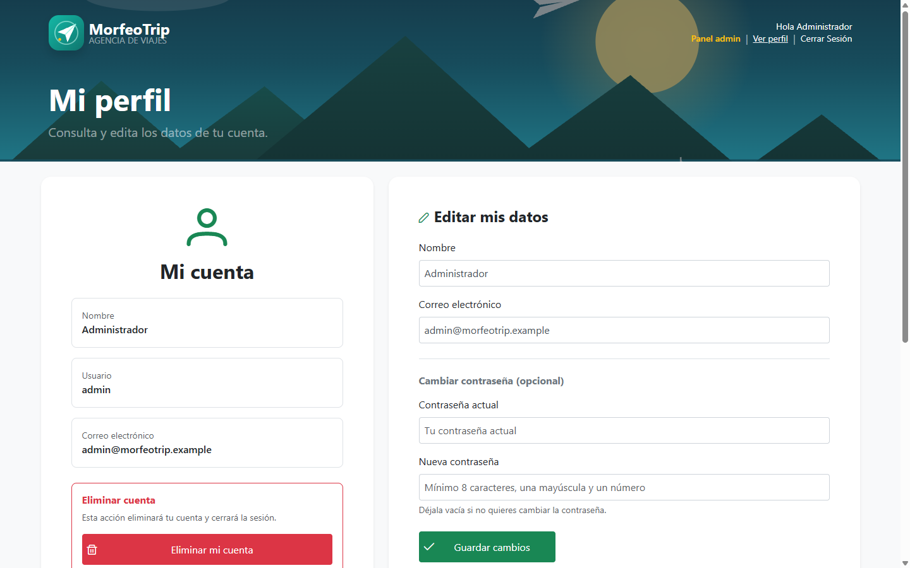
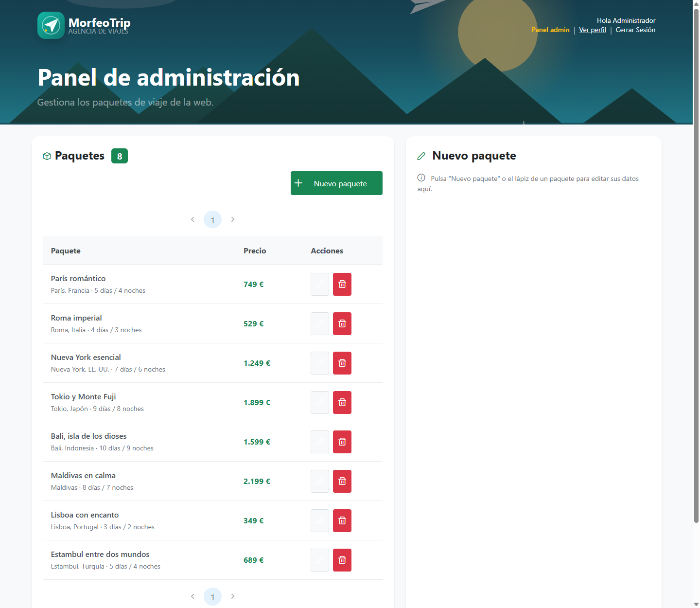
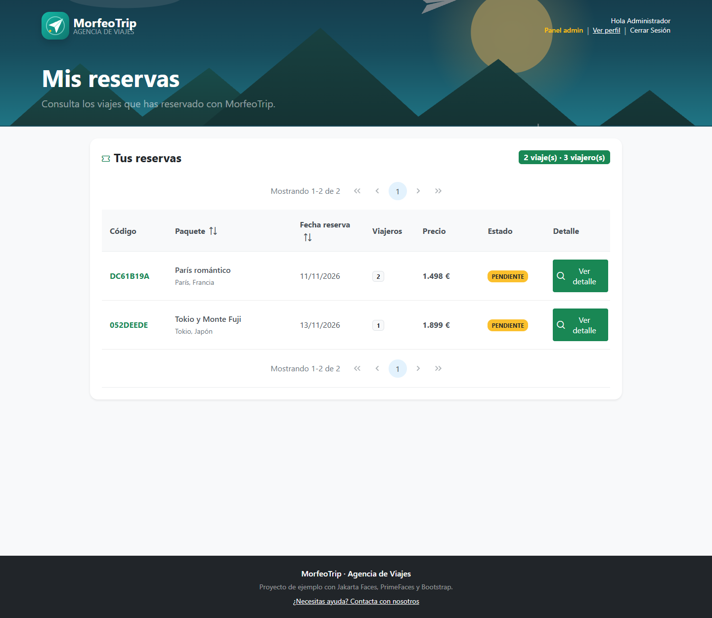

# MorfeoTrip · Agencia de Viajes

Aplicación web académica de una agencia de viajes: permite buscar paquetes, ver su detalle, comprar (con pago simulado), registrarse, iniciar sesión, editar el perfil y consultar el historial de compras. Incluye un panel de administración para gestionar los paquetes.

## Autores

- Flor Arango
- Josep Caiza
- Daniel Ochoa

## Descripción

Proyecto **Jakarta EE** empaquetado como WAR y desplegado en **Apache Tomcat 11**. Toda la lógica vive en **beans CDI** (`@Named`) y las pantallas son vistas **Facelets** (`.xhtml`) que combinan etiquetas de JSF/PrimeFaces con HTML y clases de Bootstrap.

No usa base de datos: paquetes, usuarios y reservas se guardan **en memoria** dentro de beans `@ApplicationScoped`, así que al reiniciar el servidor se vuelve al estado inicial. La validación de formularios se hace **en el servidor** (no hay JavaScript ni CSS propios).

## Tecnologías

| Tecnología | Versión | Uso |
| --- | --- | --- |
| Java | 17 | Lenguaje |
| Jakarta Faces (Mojarra) | 4.1.4 | Framework de vistas |
| PrimeFaces | 15.0.9 | Componentes de UI (tablas, diálogos, calendario, máscaras…) |
| CDI (Weld) | 6.0.3 | Inyección de dependencias y ámbito de los beans |
| Bootstrap | 5.3 | Maquetación y estilos |
| Apache Tomcat | 11 | Servidor de aplicaciones |
| Maven | 3.x | Construcción y empaquetado (WAR) |

## Capturas

### Dashboard


### Inicio de sesión


### Perfil de usuario


### Panel de administración


### Mis reservas


---

## Páginas

| Página | Descripción |
| --- | --- |
| `dashboard.xhtml` | Inicio. Buscador por país y fechas, carrusel de ofertas y destinos destacados. |
| `busqueda.xhtml` | Resultados de la búsqueda según país y duración elegidos. |
| `detallePaquete.xhtml` | Ficha del paquete (imagen, hotel, incluidos, itinerario, fotos), selector de viajeros y precio total. |
| `pago.xhtml` | Resumen del pedido y pago simulado con tarjeta o transferencia. Exige sesión iniciada. |
| `login.xhtml` | Inicio de sesión; al autenticarse redirige al dashboard. |
| `register.xhtml` | Alta de usuario con validación de nombre, correo y contraseña. |
| `perfil.xhtml` | Datos de la cuenta, edición de perfil, cambio de contraseña y baja de cuenta. |
| `misReservas.xhtml` | Historial de paquetes comprados por el usuario, con detalle de cada reserva. |
| `adminPaquetes.xhtml` | Panel exclusivo del administrador: alta, edición y borrado de paquetes. |
| `contacto.xhtml` | Formulario de contacto con validación en servidor. |

## Beans

| Bean | Ámbito | Descripción |
| --- | --- | --- |
| `UsuarioBean` | `@SessionScoped` | Usuario autenticado, login/logout, rol de administrador y edición del perfil. |
| `UsuariosStore` | `@ApplicationScoped` | Lista de usuarios registrados; sobrevive al cierre de sesión. |
| `LoginBean` | `@ViewScoped` | Formulario de inicio de sesión y redirección al dashboard. |
| `RegisterBean` | `@ViewScoped` | Registro de nuevos usuarios con validación en servidor. |
| `DashboardBean` | `@ViewScoped` | Búsqueda por país y fechas, ofertas y destinos destacados. |
| `DetallePaqueteBean` | `@SessionScoped` | Paquete seleccionado, número de viajeros y precio total. |
| `PagoBean` | `@ViewScoped` | Resumen del pedido, pago simulado, registro de la reserva y aviso de sesión requerida. |
| `ReservasBean` | `@ViewScoped` | Historial de reservas del usuario y detalle de una compra. |
| `PaquetesStore` | `@ApplicationScoped` | Catálogo de paquetes compartido por el dashboard y el panel de administración. |
| `AdminPaquetesBean` | `@SessionScoped` | Operaciones CRUD de paquetes desde el panel de administración. |
| `ContactoBean` | `@RequestScoped` | Validación y envío del formulario de contacto. |

Clases de apoyo: `modelo/` (PaqueteViaje, DetallePaquete, Reserva, Ciudad), `servicio/DetallePaqueteServicio` (fichas ampliadas de cada paquete), `validadores/` (número de tarjeta con Luhn y caducidad) y `utilidades/Util` (mensajes de JSF).

## Plantilla y componentes reutilizables

| Archivo | Tipo | Descripción |
| --- | --- | --- |
| `WEB-INF/templates/templateAgencia.xhtml` | Plantilla Facelets | Estructura común: cabecera con logo y menú según sesión (invitado / usuario / admin), banner con título y subtítulo, contenido y pie de página. |
| `resources/components/resumenPago.xhtml` | Componente composite | Tarjeta de resumen del pedido: paquete, alojamiento, incluidos, precio por persona, viajeros y total. |
| `resources/components/carruselFotos.xhtml` | Componente composite | Carrusel Bootstrap de fotos del destino usado en el detalle del paquete. |

## Estructura del proyecto

```text
pruebas-tomcat/
├── pom.xml
├── README.md
├── docs/
│   └── screenshots/            # capturas usadas en este README
└── src/main/
    ├── java/es/fempa/
    │   ├── UsuarioBean.java
    │   ├── UsuariosStore.java
    │   ├── LoginBean.java
    │   ├── RegisterBean.java
    │   ├── DashboardBean.java
    │   ├── DetallePaqueteBean.java
    │   ├── PagoBean.java
    │   ├── ReservasBean.java
    │   ├── PaquetesStore.java
    │   ├── AdminPaquetesBean.java
    │   ├── ContactoBean.java
    │   ├── converter/CiudadConverter.java
    │   ├── modelo/            # PaqueteViaje, DetallePaquete, Reserva, Ciudad
    │   ├── servicio/          # DetallePaqueteServicio
    │   ├── utilidades/        # Util (mensajes JSF)
    │   └── validadores/       # TarjetaValidator, CaducidadValidator
    ├── resources/             # configuración (beans.xml)
    └── webapp/
        ├── dashboard.xhtml
        ├── busqueda.xhtml
        ├── detallePaquete.xhtml
        ├── pago.xhtml
        ├── login.xhtml
        ├── register.xhtml
        ├── perfil.xhtml
        ├── misReservas.xhtml
        ├── adminPaquetes.xhtml
        ├── contacto.xhtml
        ├── WEB-INF/
        │   ├── web.xml
        │   ├── beans.xml
        │   └── templates/templateAgencia.xhtml
        └── resources/
            ├── components/    # resumenPago.xhtml, carruselFotos.xhtml
            └── images/        # logo y fondos SVG
```

## Ejecución

Requisitos: JDK 17 y Apache Tomcat 11.

```bash
mvn clean package
# copiar target/appViajes.war a la carpeta webapps de Tomcat y arrancarlo
```

La aplicación queda en `http://localhost:8080/appViajes/`. Usuario de prueba administrador: `admin` / `1234`.
